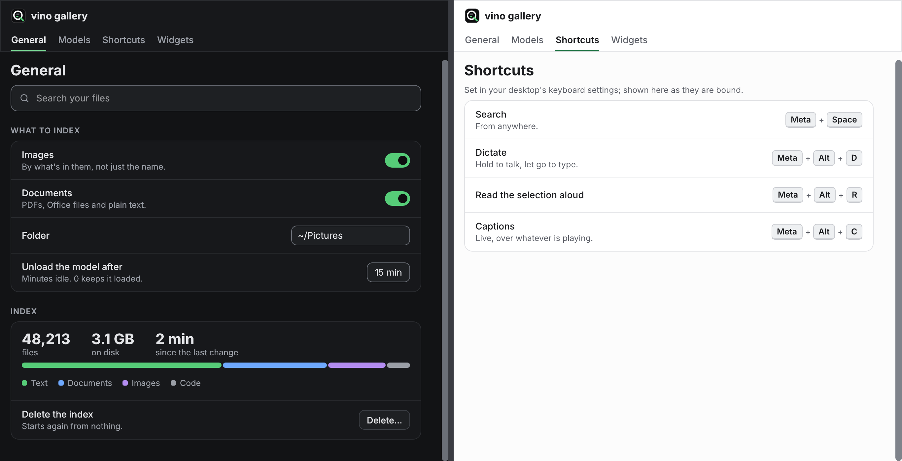
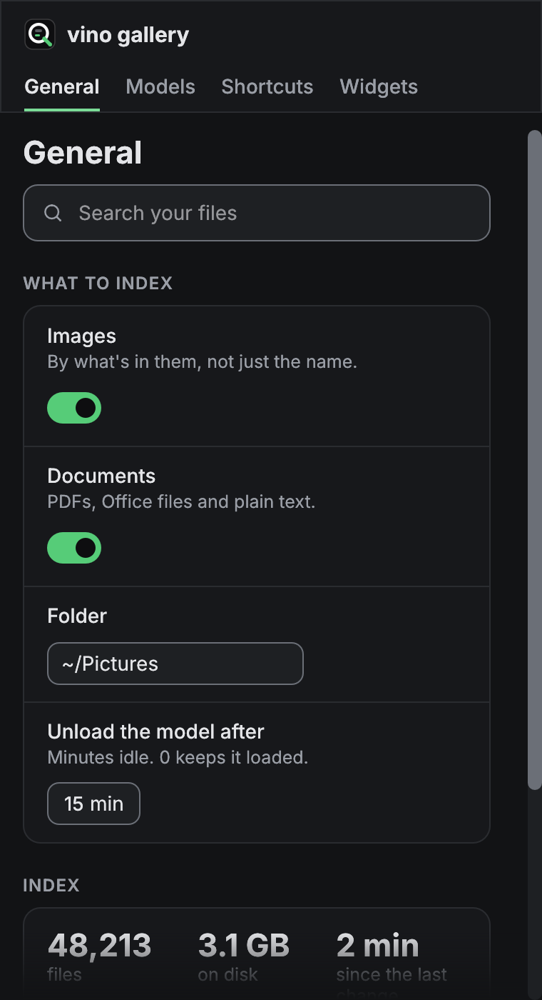

# vino UI design guidelines

How a vino window is laid out, and why. The crate holds the parts; this is
how to put them together. When the code and this disagree, the code's tests
win and this file is the bug.

The one assumption behind everything here: **a vino app runs on a laptop,
and often on half of one.** Screen height is the scarce thing, a window gets
snapped to one side next to a browser or an editor, and the desktop's text
size may be turned up. Every rule below follows from that.

## The screens we design for

Logical pixels, after the desktop's scaling. A 2880 x 1800 panel at 200 % is
a 1440 x 900 screen to egui.

| Screen | Common as | Full window | Snapped half | Quarter tile |
|---|---|---|---|---|
| 1280 x 720 | 1920 x 1080 at 150 % | 1280 x ~680 | 636 x ~680 | 636 x ~330 |
| 1366 x 768 | budget 14" and 15" | 1366 x ~730 | 679 x ~730 | 679 x ~355 |
| 1280 x 800 | 2560 x 1600 at 200 % | 1280 x ~760 | 636 x ~760 | 636 x ~370 |
| 1440 x 900 | 2880 x 1800 at 200 % | 1440 x ~860 | 716 x ~860 | 716 x ~420 |
| 1536 x 864 | 1920 x 1080 at 125 % | 1536 x ~820 | 764 x ~820 | 764 x ~400 |

Heights lose a top bar or panel and a title bar, roughly 40 to 80 px. The
snapped half loses a few px to the compositor's gap.

What that means in practice:

- **Open at 960 x 680 or smaller.** 680 tall is the most that fits a 1280 x
  720 screen with a panel and a title bar. A window that opens taller than
  the screen gets its bottom cut off by the compositor, and the user has to
  find the resize handle before they can use it.
- **Allow down to 340 x 320.** Small enough for a quarter tile, big enough
  that a row still reads. Every app already sets this; keep it.
- **Remember the size the user left it at.** Someone who snapped it once
  wants it snapped next time.

## The three widths

A window has three layouts, picked by width alone. The crate owns the
breakpoints; an app reads them, it doesn't pick its own.

| Window width | Pages | Rows | Constants |
|---|---|---|---|
| `SIDEBAR_FROM` (702) and up | sidebar, 200 wide | control beside the label | `SIDEBAR_WIDTH`, `PAGE_INSET` |
| under 702 | underline tabs under the header | beside, until the row is under 440 | `widgets::tab` |
| row under `NARROW` (440) | tabs | control under the label | `NARROW` |

`SIDEBAR_FROM` is derived, not chosen: it is the narrowest window where the
sidebar still leaves a row 440 wide. Below it, the sidebar would cost 200 px
and push every row into the stacked layout, which is the worst of both. So
half a 1366 or 1280 screen gets tabs and wide rows, and half a 1440 screen or
wider keeps the sidebar.

### Text size counts as width

The desktop's text scale is applied as egui zoom, so at 2x text a 960 window
lays out as a 480 one: tabs, and maybe stacked rows. Nothing extra to do if
you use the constants above, but test a page at `set_zoom_factor(2.0)` as
well as at a narrow width. The apps' tests do both.

## Vertical space

On a 16:9 laptop the window runs out of height long before width. Spend it
carefully.

- **No hero areas.** The page title is 22 px and sits right at the top. No
  banners of illustration, no welcome blocks, no big empty states. An empty
  list is one muted line saying what would go there and how.
- **One line of help.** A row's help is a sentence, not a paragraph. If it
  needs more, the setting is probably two settings, or the detail belongs in
  the docs.
- **Controls beside labels.** A row with its control beside the label is 54
  px; stacked, the same row is 80 to 100. This is why the breakpoints above
  protect the side-by-side layout for as long as they can.
- **Nothing pinned at the bottom** that is taller than one control row. A
  footer of buttons on a 330 px quarter tile eats a third of the window. Save
  happens on change (see [Patterns](#patterns)), so most pages need no
  footer at all.
- **Scroll the page, not parts of it.** One `page_scroll` per page. Nested
  scroll areas trap the wheel and hide content on short windows. A long list
  inside a page gets a fixed height of a few rows only when the list itself
  is the page's point (a log viewer, search results); otherwise let it grow.
- **The scroll bar is always visible** and the bottom fades while there is
  more below (`fade_below`). On a short window, a bar that only shows on
  hover is easy to miss.

## Horizontal space

- **Settings columns stop at `CONTENT_MAX` (620).** Rows wider than that put
  the label and its control too far apart to read as a pair. The column sits
  at the left, next to the sidebar or tabs, so the eye doesn't travel.
- **Content that is the point goes full width.** Search results, a session
  transcript, a log, a preview: no cap. A cap there just wastes the width a
  maximised window was maximised for.
- **The scroll bar lives on the window's edge**, with `SCROLL_GAP` (24)
  between it and the content. The central panel has no right margin for this
  reason.
- **Truncate on one line, wrap in a paragraph.** Titles, paths (`mono`) and
  combo box text truncate and show the full text on hover. Help and banner
  text wrap.

## Tokens

### Colour

Every colour has one job. `theme::palette(ctx)` gives the current theme's.

| Token | Job |
|---|---|
| `bg` | the page |
| `surface` | groups, the sidebar, the header |
| `field` | text fields, combo boxes, secondary buttons, menus |
| `pressed` | a pressed control, the track of a switch that is off |
| `rule` | hairlines between rows and around groups |
| `rule_strong` | the outline of a button or a menu |
| `edge` | the outline of a field or checkbox, slider rails, scroll handles: 3:1 |
| `text`, `muted` | body text and secondary text: both 4.5:1 on every ground |
| `accent` | links, the selected nav item, focus rings |
| `primary_fill`, `primary_text` | the primary button, a switch that is on |
| `tint` | a selected row, nav item or chip |
| `warn`, `warn_tint` | needs the user |
| `error`, `error_tint` | failed |
| `kinds` | the four series of a share bar, nowhere else |

- **Green means on, selected or done.** Not "brand", not decoration. If
  something is green it is one of those three.
- **Amber means it needs you; red means it failed.** A warning the user can't
  act on isn't a warning; make it muted text.
- **Don't add colours in an app.** If a window needs one the palette lacks,
  it goes in the palette with a job and a contrast test.
- **One shadow:** menus and popups. Everything else is flat, separated by
  hairlines.

### Type

Inter for everything, JetBrains Mono for paths and commands only.

| Use | Size | Weight | Widget |
|---|---|---|---|
| page title | 22 | bold | `title` |
| big number | 22 | bold | `stat` |
| window title in a header | 16 | semibold | `window_title` |
| row title | 14 | medium | `Row` |
| body | 14 | regular | `ui.label` |
| button | 13.5 (12.5 small) | medium, semibold for primary | `Button` |
| help, captions | 12.5 | regular, muted | `small`, `group_help` |
| group label | 12, caps, +0.7 spacing | semibold, muted | `group_label` |
| tag | 10.5, caps | bold | `tag` |
| path, command | 12.5 | mono | `mono` |

Sentence case everywhere except the two caps styles, which the widgets do for
you. Pass them normal text.

### Size and space

| Thing | Size |
|---|---|
| button, field, combo box | 30 tall (`CONTROL_HEIGHT`) |
| small button, in a list row or banner | 26 (`SMALL_HEIGHT`) |
| switch | 38 x 22 |
| status chip / filter chip | 24 / 28 tall |
| nav item | 34 tall |
| icon | 16 on a body line, 18 to 20 standing alone |
| row padding | 16 x 12 |
| spacing between items | 8 |
| corner radius | 8 controls, 10 menus and the search field, 12 groups and banners |

Spacing comes from the scale 2, 4, 6, 8, 10, 12, 14, 16, 20, 24, 28. Reach for
8 first. Don't invent 9.

Every interactive target is at least 24 x 24, or has room around it
(WCAG 2.5.8). `tests/a11y.rs` checks this.

## Components: which one when

| Need | Use | Not |
|---|---|---|
| a setting that is on or off | `switch` in a `Row` | a checkbox |
| one of 2 to 4 short options | `segmented` | radio buttons, a combo box |
| one of 5 or more, or long names | `combo` | `segmented` |
| a value to type | `field` | |
| the main action of the view | `Button::primary`, one per view | two primaries |
| other actions | `Button::secondary` | |
| a low-stakes action next to others (Cancel, Dismiss) | `Button::ghost` | |
| the action that destroys something | `Button::destructive`, only inside a confirmation | a red button sitting in a page |
| an action with only an icon | `icon_button`, with a name | a bare `icons::icon` with a click sense |
| a status at a glance | `chip`, `chip_busy` while it works | coloured text |
| filtering a list | `toggle_chip` | switches |
| a label on a thing (Beta, PDF) | `tag` | a chip |
| a shortcut | `keys("Meta+Alt+D")` | plain text |
| a page-level condition the user should fix | `banner` with its fix as the action | a modal |
| something that just failed | `notice` | a modal |
| pages | `nav_item` in the sidebar, `tab` when narrow | both at once |

### Groups and rows

Settings live in a `group` of `Row`s under a `group_label`. A group is a
handful of related settings; more than about seven rows wants splitting into
two groups or two pages.

- Pass a row's control through the `named` function the closure gets, so a
  screen reader calls it by the row's title. A switch takes its name as an
  argument instead.
- A group masks its corners with the page colour, so **put groups on the
  page only**, not on a surface or inside another group.
- Free content inside a group (a stats strip, a preview) goes in a
  `group_section`, which pads it like a row.

## Patterns

- **Save on change.** A switch takes effect when flipped, a field when it
  loses focus. No Save button, no "unsaved changes" state. The exceptions are
  things that are expensive or can't be undone, which get a confirmation.
- **Confirm in place, not in a dialog.** The row turns `error_tint` with
  `Tone::Error` help saying what will happen, and its control becomes
  `Destructive` plus a `Ghost` Cancel. A modal covers the window, and on a
  half-width window there is nowhere else to look. The gallery's "Delete the
  index" row does this.
- **Status in one place.** The app's overall state (running, paused, needs a
  restart) is one `chip` at the foot of the sidebar, live so a screen reader
  hears it change. Per-setting state goes in that row.
- **Busy means a spinner and words.** `chip_busy("Indexing")`, or a
  `spinner` beside text saying what is happening. Never a spinner alone.
  Progress you can measure gets a `progress` bar and the numbers in the help.
- **Follow the desktop.** `theme::install` at start; `follow_desktop` and the
  text scale again whenever the window regains focus. Never ship a theme
  toggle in an app: the desktop has one.

## Motion

Motion is feedback, not decoration. A switch slides, a hover fills, a spinner
turns at 10 fps. Nothing pulses, glows or bounces to get attention. When the
desktop asks for reduced motion, `theme::still` is true, transitions are
instant and the spinner stands still; anything new that moves checks it too.

## Accessibility

The crate's tests hold these, and an app's tests should hold them for its own
windows:

- Text 4.5:1, control edges 3:1, against every ground, both themes
  (`cargo test contrast`).
- Every control has a role and a name; Tab reaches every control and leaves
  it; headings, tab lists and live regions are announced (`tests/a11y.rs`).
- Painted-only things (icons beside text, logos, progress bars) are
  `a11y::decorative`. Anything that carries meaning on its own gets a name.
- A repeated button text says what it acts on: `a11y::for_what(remove,
  "~/Downloads")` reads "Remove ~/Downloads".

## Words

- Sentence case. No "Please", no exclamation marks, no "successfully".
- Buttons say the action: "Delete", "Download", not "OK" or "Yes".
- Help says what happens, in the user's terms: "Every file is read again
  from scratch. This can take an hour." Not "This will reset the index."
- Errors say what failed and, if there is one, the way out: "The index
  couldn't be opened: disk full."
- Contractions are fine. Jargon the user didn't pick isn't.

## Checklist for a new window

- [ ] Opens at 960 x 680 or smaller, minimum 340 x 320, remembers its size.
- [ ] Uses `SIDEBAR_FROM` for sidebar or tabs; no breakpoints of its own.
- [ ] Looks right at 380 wide, at half of 1366 (679), at 960, and at 2x text.
- [ ] Settings in groups of rows, in a `page_scroll` capped at `CONTENT_MAX`;
      content that is the point runs full width.
- [ ] One primary button at most; destructive actions confirm in place.
- [ ] No colour, size or spacing that isn't a token.
- [ ] Every control named; the a11y checks pass in both themes.
