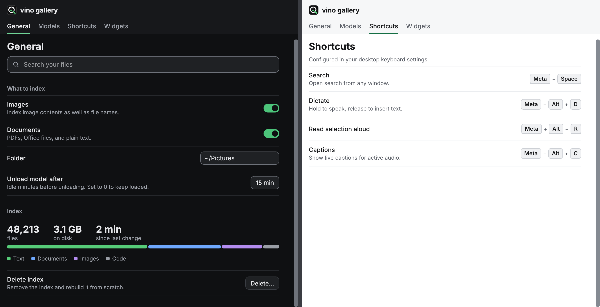
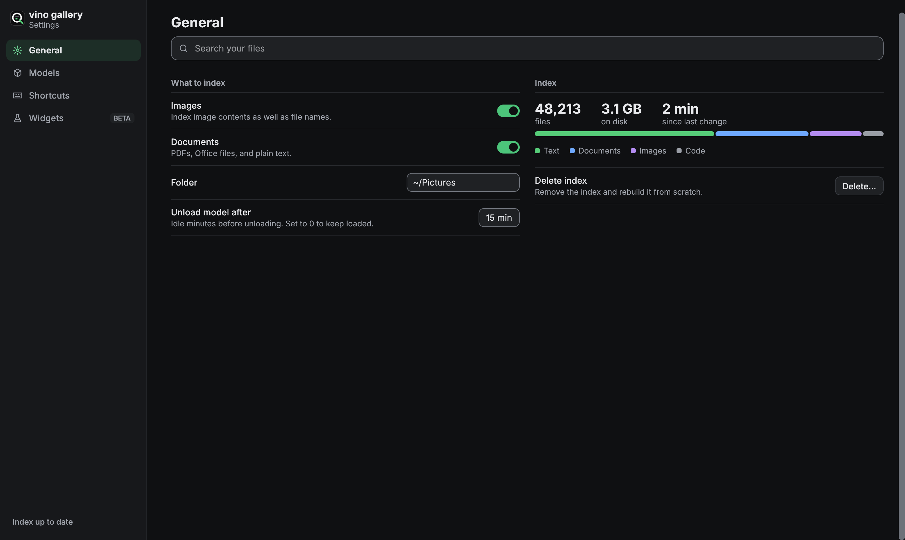
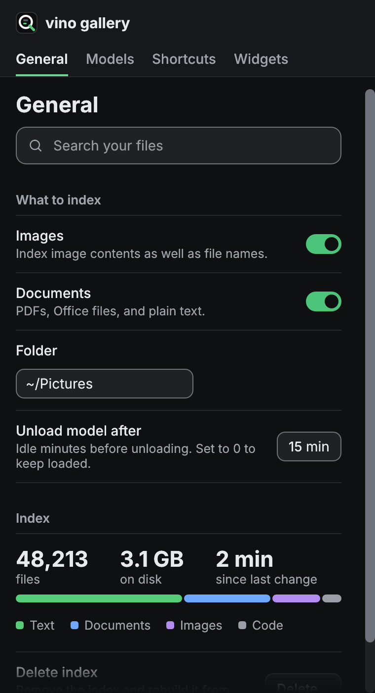

# vino UI design guidelines

Layout, token, component, and copy guidelines for vinoPilot desktop windows.
This crate provides the building blocks; this document explains how to assemble
them. If this document conflicts with the code or tests, treat the tests as
authoritative and update this file.

The core design constraint is that **vino apps run on laptop screens and are
frequently snapped to half the display width.** Vertical space is limited,
windows often sit beside a browser or editor, and desktop text scaling may be
increased. The layout rules below follow from these constraints.

## Target screen sizes

Values below are in logical pixels after desktop display scaling (for example, a
2880 x 1800 panel at 200% scaling appears as 1440 x 900 to egui).

| Screen | Common configuration | Full window | Snapped half | Quarter tile |
|---|---|---|---|---|
| 1280 x 720 | 1920 x 1080 at 150% | 1280 x ~680 | 636 x ~680 | 636 x ~330 |
| 1366 x 768 | 14" and 15" laptops | 1366 x ~730 | 679 x ~730 | 679 x ~355 |
| 1280 x 800 | 2560 x 1600 at 200% | 1280 x ~760 | 636 x ~760 | 636 x ~370 |
| 1440 x 900 | 2880 x 1800 at 200% | 1440 x ~860 | 716 x ~860 | 716 x ~420 |
| 1536 x 864 | 1920 x 1080 at 125% | 1536 x ~820 | 764 x ~820 | 764 x ~400 |

Usable heights exclude the desktop panel and title bar (roughly 40 to 80 px).
Snapped halves also lose a few pixels to compositor gaps.

Window sizing rules:

- **Default to 960 x 680 or smaller.** 680 px fits cleanly on a 1280 x 720
  display with a panel and title bar. Taller initial windows can have their
  bottom clipped by the compositor.
- **Support resizing down to 340 x 320.** This accommodates quarter-screen
  tiling while keeping rows readable.
- **Persist window size.** Restoring the last window size preserves half-screen
  and custom layouts across launches.

## Responsive breakpoints

Windows switch between four layouts based on width alone. Applications should
use the crate's breakpoint constants rather than defining custom thresholds.

| Window width | Navigation | Rows | Constants |
|---|---|---|---|
| Page width `TWO_COLUMNS_FROM` (904) and up (~1200 window width) | Sidebar, groups in two columns | Control beside label | `columns`, `WIDE_MAX` |
| `SIDEBAR_FROM` (702) and up | Sidebar (200 to 240 px wide) | Control beside label | `sidebar_width`, `page_inset` |
| Under 702 | Underline tabs under the header | Control beside label until row width drops below 440 | `widgets::tab` |
| Row width under `NARROW` (440) | Tabs | Control stacked below label, unless the control leaves at least 160 px for the label (such as a switch or numeric field) | `NARROW` |

`SIDEBAR_FROM` is derived as the narrowest window width where a 200 px sidebar
still leaves each row 440 px wide. Below that width, keeping a sidebar would
force every row to stack vertically. As a result, a half-tiled 1366 or 1280
display uses top tabs with horizontal rows, while a half-tiled 1440 display
keeps the sidebar.

`TWO_COLUMNS_FROM` is derived similarly: two 440 px columns separated by
`COLUMN_GAP` (24 px). Because it measures page width rather than total window
width, it adapts automatically to sidebar width and text scaling (typically
splitting into two columns around 1200 px window width, covering full 1280 and
1366 displays).

### Fluid frame sizing

Between `SIDEBAR_FROM` and `FLUID_TO` (1600), the sidebar scales smoothly from
200 px to `SIDEBAR_MAX` (240 px), and the page inset scales from 28 px to
40 px. Call `sidebar_width` and `page_inset` with the current window width each
frame rather than hardcoding constants. Growth is bounded so the content area
never shrinks as the window widens. Internal row dimensions (heights, padding,
and font sizes) remain fixed because text size is controlled by desktop scaling.

### Text scaling and layout width

Desktop text scaling is applied via egui's zoom factor, so a 960 px window at
2x text scale lays out identically to a 480 px window (using top tabs and
stacked rows where needed). Using the constants above handles this
automatically, though pages should be tested both at narrow widths and with
`set_zoom_factor(2.0)`.

## Vertical space

On 16:9 laptop screens, vertical height is tighter than horizontal width:

- **Avoid hero areas.** Place the 22 px page title directly at the top with no
  illustrations, welcome blocks, or oversized empty states. Represent an empty
  list with a single muted line explaining what will appear there.
- **Keep help text to one sentence.** If a setting requires a paragraph of
  explanation, consider splitting it into two settings or moving the detail to
  documentation.
- **Keep controls beside labels.** A horizontal row is 54 px tall, whereas a
  stacked row is 80 to 100 px tall. The breakpoints above preserve horizontal
  rows as long as possible, and compact controls such as switches remain inline
  even on narrow rows.
- **Avoid tall pinned footers.** Do not pin anything taller than a single
  control row to the bottom; on a 330 px quarter tile, a button footer consumes
  a third of the viewport. Because settings save immediately on change (see
  [Patterns](#patterns)), most pages need no footer.
- **Use one scroll area per page.** Wrap each page in a single `page_scroll` and
  avoid nested scroll containers, which trap scroll events and obscure content
  on short windows. Only give an embedded list a fixed height when the list
  itself is the primary view (such as search results or a log viewer).
- **Keep scroll bars visible.** Scroll bars remain visible at all times, and
  `fade_below` indicates remaining content off-screen. Hover-only scroll bars
  are easy to miss in short windows.

## Horizontal space

- **Cap settings columns at `CONTENT_MAX` (620).** Wider rows separate labels
  from their controls too far to scan comfortably. Left-align the column next to
  the sidebar or header tabs.
- **Use `columns` for pages with two or more groups.** At wide widths, groups
  sit side by side in two columns (each capped at `CONTENT_MAX`). At narrower
  widths, the right column stacks below the left column, so place the most
  important group on the left. Pass `WIDE_MAX` to `page_scroll`; elements placed
  above `columns` (such as a search field or banner) span both columns. Single
  groups and strictly sequential lists stay in one column.
- **Allow primary content views to span full width.** Search results,
  transcripts, logs, and previews should not be capped at `CONTENT_MAX`.
- **Place scroll bars on the window edge.** Leave `SCROLL_GAP` (24 px) between
  content and the scroll bar, and omit right margin on the central panel.
- **Truncate single-line items; wrap paragraphs.** Truncate titles, file paths
  (`mono`), and combo box values with hover tooltips for the full string. Allow
  help text and banners to wrap naturally.

## Tokens

### Colour

Each colour token has a dedicated semantic role. Retrieve the active theme's
palette with `theme::palette(ctx)`.

| Token | Role |
|---|---|
| `bg` | Page canvas |
| `surface` | Sidebar, header, and neutral strips |
| `field` | Text fields, combo boxes, secondary buttons, and menus |
| `pressed` | Pressed control fill and off-state switch track |
| `rule` | Hairline dividers between rows and bounding groups |
| `rule_strong` | Button and menu borders |
| `edge` | Field/checkbox borders, slider rails, and scroll handles (3:1 contrast) |
| `text`, `muted` | Primary and secondary text (both at least 4.5:1 on every background) |
| `accent` | Links, active navigation item icon, and focus rings |
| `primary_fill`, `primary_text` | Primary button (dark ink on light theme, near-white on dark theme) |
| `on`, `switch_knob` | Active switch track and knob |
| `danger`, `danger_text` | Destructive action button |
| `tint` | Selected row, active navigation item, or active filter chip |
| `warn`, `warn_tint`, `warn_rule` | Warnings requiring user attention |
| `error`, `error_tint`, `error_rule` | Errors and failures |
| `kinds` | Four data series for share bars only |

Colour usage rules:

- **Keep defaults quiet so non-default states stand out.** Emphasis comes from
  contrast with surrounding controls rather than heavy chrome. Inactive filter
  chips, ghost actions, off switches, and normal status text stay muted or grey
  so active, warning, and error states catch the eye immediately.
- **Reserve green for active, selected, or completed states.** Do not use green
  for decoration or branding; primary buttons use `primary_fill` (ink/white)
  rather than green in both themes.
- **Use amber for actionable warnings and red for errors.** If the user cannot
  act on a message, display it as muted text instead of a warning. Informational
  labels such as "Beta" use a neutral grey `tag`.
- **Use colour for state, not emphasis.** Rely on font weight and layout
  hierarchy rather than coloured text, bullets, or dividers.
- **Keep colour definitions in the crate.** If an application needs a new
  semantic colour, add it to `Palette` with a corresponding contrast test.
- **Use fixed colours on ink tiles.** App logos and `file_tile::file` render on
  an ink background in both themes with a white mark and a single format accent
  colour: red for PDF, blue for documents, orange for slides, purple for books,
  yellow for subtitles, green for Markdown, teal for spreadsheets, pink for
  code, cyan for images, and grey for plain text. Like `kinds`, these accents
  are reserved for format identification on ink tiles. Each accent meets 3:1
  contrast against ink (`cargo test contrast`), and every format also has a
  distinct icon shape so colour is not the sole indicator.
- **Limit shadows to menus and popups.** Keep all other surfaces flat with
  hairline dividers rather than boxed cards, gradients, glows, or translucent
  panels. The only gradient is `fade_below` to indicate scrollable content.

### Typography

Use Inter for all UI copy and JetBrains Mono exclusively for file paths and
commands.

| Element | Size | Weight | Widget |
|---|---|---|---|
| Page title | 22 | Bold | `title` |
| Metric figure | 22 | Bold | `stat` |
| Header window title | 16 | Semibold | `window_title` |
| Row title | 14 | Medium | `Row` |
| Body text | 14 | Regular | `ui.label` |
| Button label | 13.5 (12.5 small) | Medium (Semibold for primary) | `Button` |
| Help text and captions | 12.5 | Regular, muted | `small`, `group_help` |
| Group label | 13, sentence case | Semibold, muted | `group_label` |
| Tag | 10.5, uppercase | Semibold | `tag` |
| Path or command | 12.5 | Monospace | `mono` |

Use sentence case everywhere except tags, which `widgets::tag` uppercases
automatically.

### Sizing and spacing

| Element | Dimensions |
|---|---|
| Button, text field, combo box | 30 px tall (`CONTROL_HEIGHT`) |
| Small button (in list rows or banners) | 26 px tall (`SMALL_HEIGHT`) |
| Switch | 36 x 20 px |
| Status text / filter chip | 24 px / 28 px tall |
| Navigation item | 34 px tall |
| Icon | 16 px inline with text, 18 to 20 px standalone |
| Row vertical padding | 12 px above and below (0 px horizontal, flush on column edges; 12 px horizontal when tinted) |
| Banner and notice padding | 15 px left (past 3 px accent bar), 12 px right, 10 px vertical |
| Tag padding | 6 px horizontal, 16 px tall |
| Sidebar | 10 px horizontal margin; nav icon centred at 18 px, text at 36 px; 24 px logo |
| Default item spacing | 8 px |
| Corner radius | 8 px for controls; 6 px on trailing corners of banners; 10 px for menus and search fields |

Use spacing values from the scale `2, 4, 6, 8, 10, 12, 14, 16, 20, 24, 28`,
defaulting to `8` unless another step is needed.

Every interactive target must be at least 24 x 24 px or have sufficient spacing
around it to meet WCAG 2.5.8 (verified by `tests/a11y.rs`).

## Component selection

| Use case | Recommended widget | Avoid |
|---|---|---|
| On/off setting | `switch` inside a `Row` | Checkbox |
| 2 to 4 short mutually exclusive options | `segmented` | Radio buttons or combo box |
| 5 or more options, or long option names | `combo` | `segmented` |
| Text input | `field` | |
| Primary action for a view | `Button::primary` (at most one per view) | Multiple primary buttons |
| Standard secondary actions | `Button::secondary` | |
| Low-emphasis actions beside others (Cancel, Dismiss) | `Button::ghost` | |
| Destructive action | `Button::destructive` inside an inline confirmation | Exposed red button on a settings page |
| Icon-only action | `icon_button` with an accessible label | Bare clickable `icons::icon` |
| Short status text | `chip` (muted by default; amber or red for warnings/errors) | Status dots, pills, or green "OK" badges |
| Indeterminate wait longer than ~1 s | `spinner` paired with descriptive text | Standalone spinner or animated ellipsis |
| Determinate progress | `progress` bar with numeric progress in help text | Spinner |
| List filtering | `toggle_chip` | Switches |
| Static metadata label (Beta, PDF) | `tag` (grey unless actionable) | `chip` or amber "Beta" tag |
| File entry in a list | `file_tile::file` at 30 px (`logo::whisper` for vinoWhisper sessions) | Generic document icon for every format |
| Keyboard shortcut display | `keys("Meta+Alt+D")` | Plain text |
| Page-level actionable condition | `banner` with a remediation button | Modal dialog |
| Page-level informational note | `banner` with `Tone::Info` | Warning banner |
| Immediate failure message | `notice` | Modal dialog |
| Page navigation | `nav_item` in sidebar when wide; `tab` when narrow | Showing both simultaneously |

- **Use icons purposefully.** Reserve icons for icon-only buttons (with
  accessible names), sidebar navigation items, standard UI actions (close, more,
  back, search), and file tiles in lists. Avoid placing decorative icons in
  front of headings or labels that already explain themselves. Warning and error
  banners include an icon so status is not conveyed by colour alone; info
  banners omit icons.
- **Show actionable counts only.** Display counts where they help the user act
  (such as on filter chips), and avoid decorative badges or counters.

### Groups and rows

Place related settings in a borderless `group` of `Row` widgets under a
`group_label`. Split groups larger than roughly seven rows into separate groups
or pages so users scan short, labelled chunks rather than one undifferentiated
list.

- **Dissolve cards into the column edges.** `group` bounds its rows with 1 px
  top and bottom hairlines and separates rows with 1 px hairlines rather than
  wrapping them in rounded boxes. Labels snap flush to the left column edge
  (aligning with page titles and section labels) and controls snap flush to the
  right column edge, avoiding borders-on-borders and stacked corner radii while
  reclaiming horizontal space on narrow laptop splits.
- Wrap each row's control with the `named` callback provided to the closure so
  screen readers announce it using the row's title. Switches accept their
  accessible name directly as an argument.
- `group_on` is retained for source compatibility; borderless groups need no
  corner masking on non-page backgrounds. Do not nest groups.
- Place non-row content inside a group (such as a stats strip or preview) inside
  `group_section` to match standard row vertical rhythm and column alignment.
- Rows lay out controls from right to left (the first control added appears
  rightmost, such as Delete followed by Cancel to its left). When a row stacks
  vertically, it preserves that visual order so controls do not swap positions
  as the window resizes.
- Tinted rows (such as inline destructive confirmations) add a 3 px semantic
  left accent bar and 12 px horizontal padding. `banner` and `notice` use the
  same 3 px edge-anchored strip pattern without 4-sided card borders.

### Sidebar and narrow header

`sidebar_frame` contains `sidebar_brand` (24 px logo aligned with the nav icon
column, app name aligned with the nav text column, and a subtitle line),
`nav_item` entries, and `sidebar_foot` (a status `chip` pinned at the bottom),
followed by `panel_rule` along the sidebar's edge. In narrow windows,
`header_frame` uses the same horizontal `inner_margin` as the page and draws its
bottom hairline outside that margin.

### Client-side title bar

The `window` module lets an application render its own window controls inside
the app's header rather than using system title bars. Open the viewport with
`window::viewport(builder, window::app_title_bar())`. In wide windows, the page
title moves into `window::bar` beside the sidebar with `window::controls` on the
right; in narrow windows, controls sit at the right end of the header's first
row. Call `window::drag` on the bar, header, and sidebar brand area before
drawing interactive children so dragging moves the window and double-clicking
maximises it without intercepting tab or button clicks. Call `window::edges`
last in the frame to provide resize handles and a 1 px window border when system
decorations are disabled.

In wide windows, `window::bar` places window buttons `BAR_GAP` (8 px) from the
top-right corner and clips the page title before it collides with trailing
controls. Windows that always use a top header without a sidebar (such as search
or viewer windows) can call `window::corner`, which renders controls in the
top-right corner without consuming header layout space and returns the clearance
width to reserve on the right.

`app_title_bar` defaults to `false` on tiling compositors (`sway`, `i3`,
`Hyprland`, `niri`, `river`, `qtile`), where windows normally omit title bars.
Set `VINO_UI_TITLE_BAR=app` or `system` to override detection. Limitations
compared to system title bars: egui cannot trigger the compositor's window menu
(right-click or Alt+F3), does not mirror custom desktop button ordering, and
does not draw server-side drop shadows.

## Patterns

- **Apply changes immediately.** Switches take effect on toggle and text fields
  take effect on focus loss. Avoid explicit Save buttons and "unsaved changes"
  states except for expensive or irreversible actions, which require
  confirmation.
- **Confirm destructive actions inline.** Instead of opening a modal dialog,
  tint the row with `error_tint`, set `Tone::Error` help text explaining the
  consequence, and replace the button with a `Button::destructive` action paired
  with a `Button::ghost` Cancel button. See the "Delete index" row in
  `examples/gallery.rs`.
- **Keep application status in one place.** Show the overall app or service
  state (running, paused, restart required) in a single live `chip` at the
  bottom of the sidebar so screen readers announce changes. Show per-setting
  status inside the corresponding row.
- **Represent status with plain text.** `chip` renders text without dots or
  pills: muted for normal states, amber for actionable warnings, and red for
  errors. Inline status inside a sentence uses `small`.
- **Describe background activity with words first.** Text such as "Indexing"
  already communicates ongoing work. Add a `spinner` beside the text only for
  indeterminate waits exceeding roughly one second that have no other visual
  indicator, and never display a spinner alone. Use a `progress` bar with
  numeric details for measurable operations.
- **Follow desktop preferences.** Call `theme::install` at startup, and call
  `theme::follow_desktop` whenever the window regains focus to pick up theme,
  motion, or text-scale changes. Do not add an in-app theme toggle.

## About page and app links

Every app window includes **About** (`about::TITLE`, `Icon::Info`) as its final
navigation item, rendered via `about::page(ui, App::…, env!("CARGO_PKG_VERSION"))`.
This displays the current app name, version, description, a link to
`vinopilot.ca`, and links to the other vinoPilot apps sourced from
`family::App`. Do not duplicate the app list by hand; keeping it in `family`
ensures all apps stay consistent when the crate updates. List other vinoPilot
apps only on the About page, never inside tray menus.

Apps that support self-updating use `about::page_with_updates(ui, &mut updater)`
with a persistent `update::Updater`:
`Updater::new(App::…, env!("CARGO_PKG_VERSION")).with_command([...])`, where the
command receives the target tag in `VINO_UPDATE_TAG`. This adds an **Updates**
row beneath the version:

- **Check only on demand.** Update checks never run automatically on startup or
  in the background; network access happens only when the user clicks **Check
  for updates** (or invokes an update check from a tray menu via `update`).
- **Progress one step at a time:** **Check for updates**, then **Update to vN**
  (the page's single primary button), then a restart prompt once installed.
  Errors display the installer's failure message in red alongside a **Try
  again** button.
- **Fallback without an install command.** If `with_command` is not configured,
  the row links to the GitHub release page instead of offering an install
  button.

Windows without page navigation (such as GTK dialogs or popups) should still
source app metadata from `family` and perform update checks with
`update::fetch_latest` and `update::is_newer`.

## Tray menus

System tray menus are rendered by the desktop environment, so they use desktop
icon theme names rather than painted `icons`. Select every icon from
`tray::MenuIcon` by semantic purpose rather than raw icon strings so common
actions share identical icons across all trays. Every entry uses a `-symbolic`
name present in both Breeze and Adwaita, allowing the tray host to recolour
icons for light and dark themes.

- **Attach icons to top-level actions and submenus** (Settings, Quit, links,
  and submenus).
- **Omit icons on checkable and radio items**, since the check or radio mark
  serves as the indicator.
- **Omit icons on homogeneous list entries** (such as recent dictations or
  submenu options), since the parent submenu's icon covers the group.
- **Use icons on plain-text status rows only for explicit states** (`Ok`,
  `Info`, `Question`, `Warning`, `Error`) or custom visuals such as vinoWatch's
  usage meters.
- **End every tray menu with Quit (`MenuIcon::Quit`).** Keep tray menus focused
  on the current app's controls; links to other vinoPilot apps belong on the
  About page opened via Settings.

## Motion

Use motion strictly for state feedback: switch slides, hover fills, and a
10 fps spinner during genuine waits. Avoid pulsing, glowing, blinking, or
bouncing indicators, animated status dots, cycling ellipses, and shimmer
placeholders. When desktop reduced motion is enabled, `theme::still` returns
`true`, transitions become immediate, and the spinner remains static. Any custom
animation must check `theme::still`.

## Accessibility

These requirements are enforced by crate tests and should be mirrored in
application test suites:

- Maintain at least 4.5:1 contrast for text and 3:1 for control boundaries
  against every background in both themes (`cargo test contrast`).
- Give every interactive control an accessible role and label, ensure full Tab
  navigation without focus traps, and mark headings, tab lists, and live regions
  appropriately (`tests/a11y.rs`).
- Mark purely decorative visuals (icons beside labels, logos, progress bars)
  with `a11y::decorative`; label standalone visuals that convey meaning.
- Disambiguate repeated action labels using `a11y::for_what(remove,
  "~/Downloads")` so screen readers announce `"Remove ~/Downloads"`.

## UI copy

- Use sentence case. Avoid "Please", exclamation marks, and filler adverbs such
  as "successfully".
- Label buttons with specific verbs ("Delete", "Download") instead of generic
  confirmations ("OK", "Yes").
- Write help text in concrete user terms ("All files will be re-indexed from
  scratch. This may take up to an hour.") rather than internal jargon ("Resets
  the index.").
- Write error messages that state what failed and, when possible, how to fix it
  ("Could not open the index because the disk is full.").
- Avoid marketing filler ("Magic", "Seamlessly", "AI-powered") and emoji in UI
  labels. A static ellipsis in an active status ("Checking…") is acceptable;
  animated ellipses are not.

## Checklist for a new window

- [ ] Default size is 960 x 680 or smaller, minimum size is 340 x 320, and
      window size is persisted.
- [ ] Uses `SIDEBAR_FROM`, `sidebar_width`, and `page_inset` instead of custom
      breakpoints.
- [ ] Verified at 380 px, 679 px (half of 1366), 960 px, 1440 px, and 2x text
      scale.
- [ ] Settings are placed in `group`s of `Row`s inside `page_scroll` capped at
      `CONTENT_MAX` (or `WIDE_MAX` with `columns`); primary content views span
      full width.
- [ ] At most one primary button per view; destructive actions confirm inline.
- [ ] All colours, sizes, and spacings come from crate tokens.
- [ ] Every control has an accessible name and passes `a11y` checks in both
      themes.
