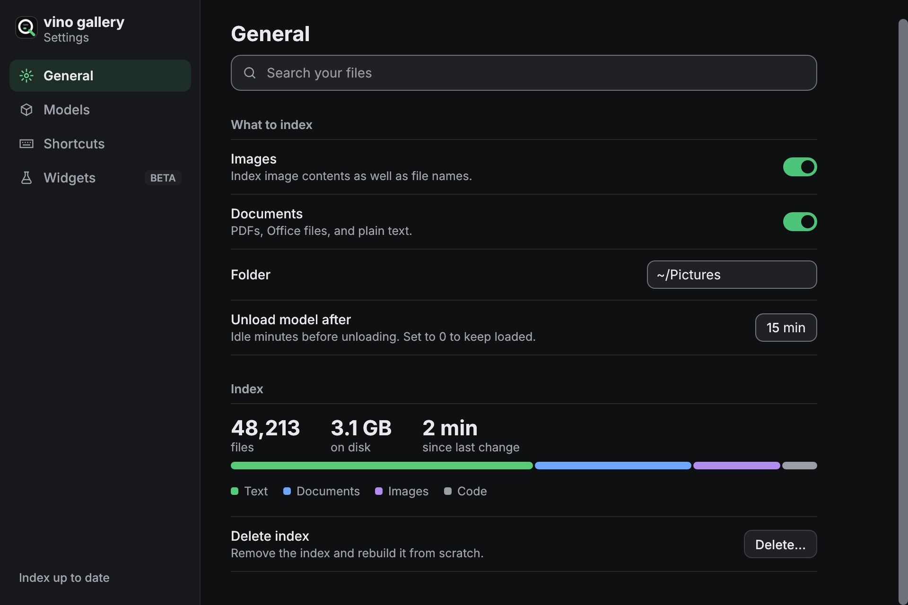
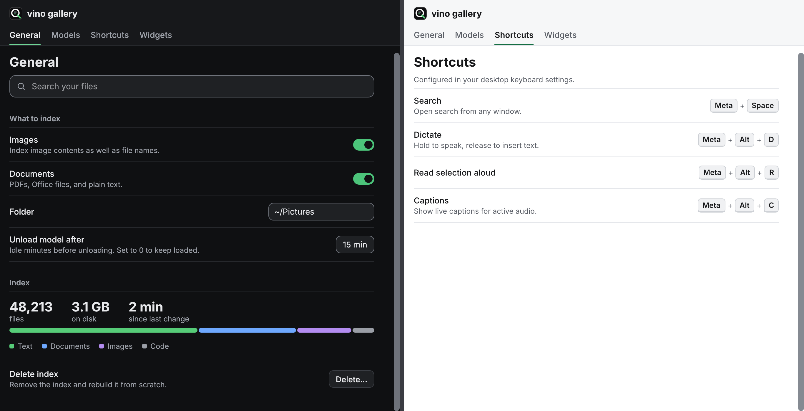

# vinoUserInterface

The egui theme and widgets the [vinoPilot](https://vinopilot.ca/) apps share,
so they have one look: Inter, flat surfaces separated by hairlines, ink and
green, taken from vinopilot.ca's site.css.

<p align="center">
  
  
</p>

Built for laptops, and for half of one. Snapped next to another window, a
page swaps its sidebar for tabs and keeps its rows wide:



## Requirements

- Rust 1.95 and egui 0.37. The app brings its own eframe.
- `busctl` or `gdbus` on `PATH` to follow the desktop's light or dark, text
  size and reduced motion. Without them it keeps egui's default theme at 1x.
- `curl`, only for the About page's update check, and only when the user asks.

## Quick start

```toml
[dependencies]
vino-user-interface = "0.5"
eframe = { version = "0.37", default-features = false, features = ["accesskit", "default_fonts", "glow", "wayland"] }
```

A tray that links no egui takes `default-features = false` and gets `family`,
`tray` and `update` only.

A settings page: a group of rows, a banner, a status line.

```rust
use eframe::egui;
use vino_user_interface::{Button, ChipKind, Row, Tone, a11y, theme, widgets};

#[derive(Default)]
struct Settings {
    images: bool,
    folder: String,
}

impl eframe::App for Settings {
    fn ui(&mut self, ui: &mut egui::Ui, _frame: &mut eframe::Frame) {
        let p = theme::palette(ui.ctx());
        egui::CentralPanel::default()
            .frame(egui::Frame::NONE.fill(p.bg).inner_margin(egui::Margin {
                left: 28,
                top: 20,
                ..Default::default()
            }))
            .show(ui, |ui| {
                widgets::page_scroll(ui, "Settings", widgets::CONTENT_MAX, |ui| {
                    widgets::title(ui, "Settings");
                    widgets::group_label(ui, "What to index");
                    widgets::group(ui, |ui| {
                        Row::new("Images")
                            .help("By what's in them, not just the name.")
                            .show(ui, |ui, _| {
                                widgets::switch(ui, &mut self.images, "Images");
                            });
                        // `named` gives the field the row's title as its accessible name.
                        Row::new("Folder").show(ui, |ui, named| {
                            named(ui.add(widgets::field(&mut self.folder, "~/Pictures", 180.0)));
                        });
                    });
                    widgets::banner(ui, Tone::Warn, "The vision model isn't downloaded yet.", |ui| {
                        ui.add(Button::primary("Download").small());
                    });
                    a11y::live(&widgets::chip(ui, ChipKind::Ok, "Index up to date"));
                });
            });
    }
}

fn main() -> eframe::Result {
    eframe::run_native(
        "Settings",
        eframe::NativeOptions {
            viewport: egui::ViewportBuilder::default()
                .with_inner_size([960.0, 680.0])
                .with_min_inner_size([340.0, 320.0]),
            ..Default::default()
        },
        Box::new(|cc| {
            // Fonts, colours and spacing, then the desktop's light or dark and motion setting.
            theme::install(&cc.egui_ctx);
            Ok(Box::new(Settings::default()))
        }),
    )
}
```

The full window is [examples/gallery.rs](examples/gallery.rs). Run it and drag
the window narrower:

```sh
cargo run --example gallery
```

## What is in it

| Module | Holds |
|---|---|
| `theme` | colour tokens for dark and light, fonts, egui's visuals and spacing, and what the desktop asks for |
| `widgets` | groups of rows, switches, buttons, status text, chips, tags, key caps, banners, navigation, the page scroll area and the layout constants |
| `icons` | a 16 px stroke icon set painted from SVG path data, no icon font |
| `logo` | the app logos, painted at any size |
| `file_tile` | a file's tile for a list, with a mark and an accent per format |
| `a11y` | headings, tabs, list boxes, live regions and names for screen readers |
| `window` | the app's own title bar, for a window opened without the desktop's |
| `about`, `update` | the About page, and its row that checks for a newer release and installs it |
| `family`, `tray` | the apps and their links, and the icon names every tray menu uses. No egui |

<p align="center">
  
  
</p>

## Docs

- [DESIGN.md](DESIGN.md): how a vino window is laid out and why. Breakpoints,
  tokens, which component when, motion, words.
- [docs/development.md](docs/development.md): the rules the tests keep, how
  the source is organised, redrawing the pictures, releasing.
- [SECURITY.md](SECURITY.md): what the crate reads and runs, and how to
  report a problem.
- [The vino UI canvas](https://claude.ai/code/artifact/f79675d7-67e0-4a99-a84d-8a22d3b3a8f6):
  the boards this implements.
