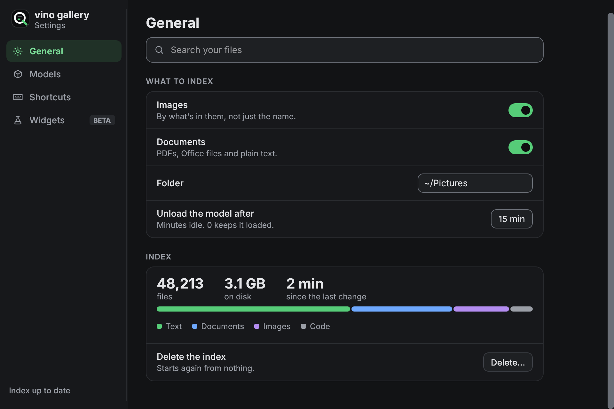
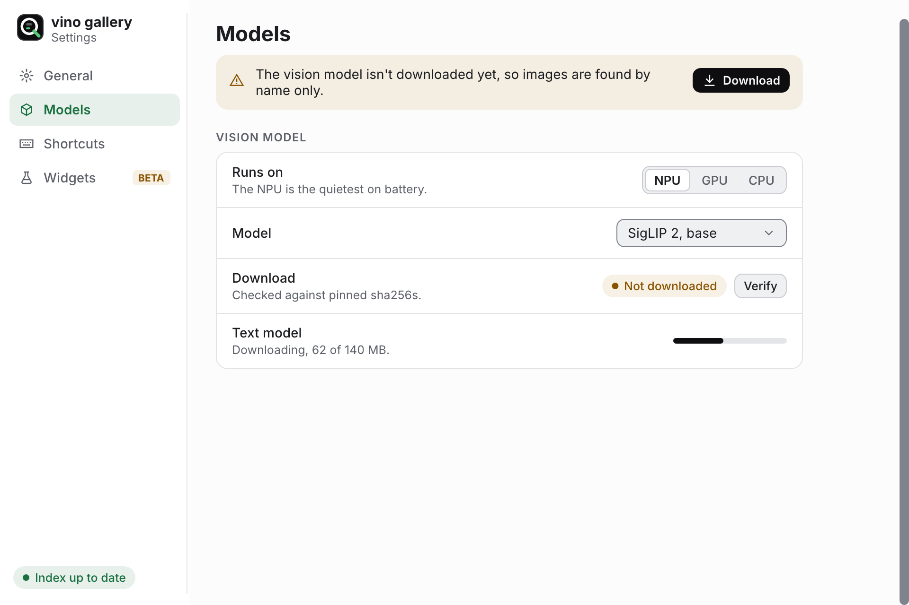
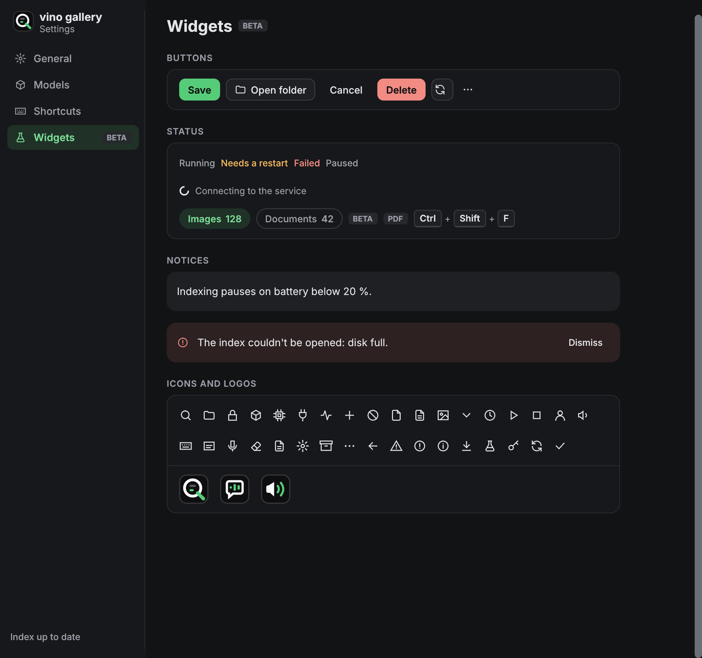
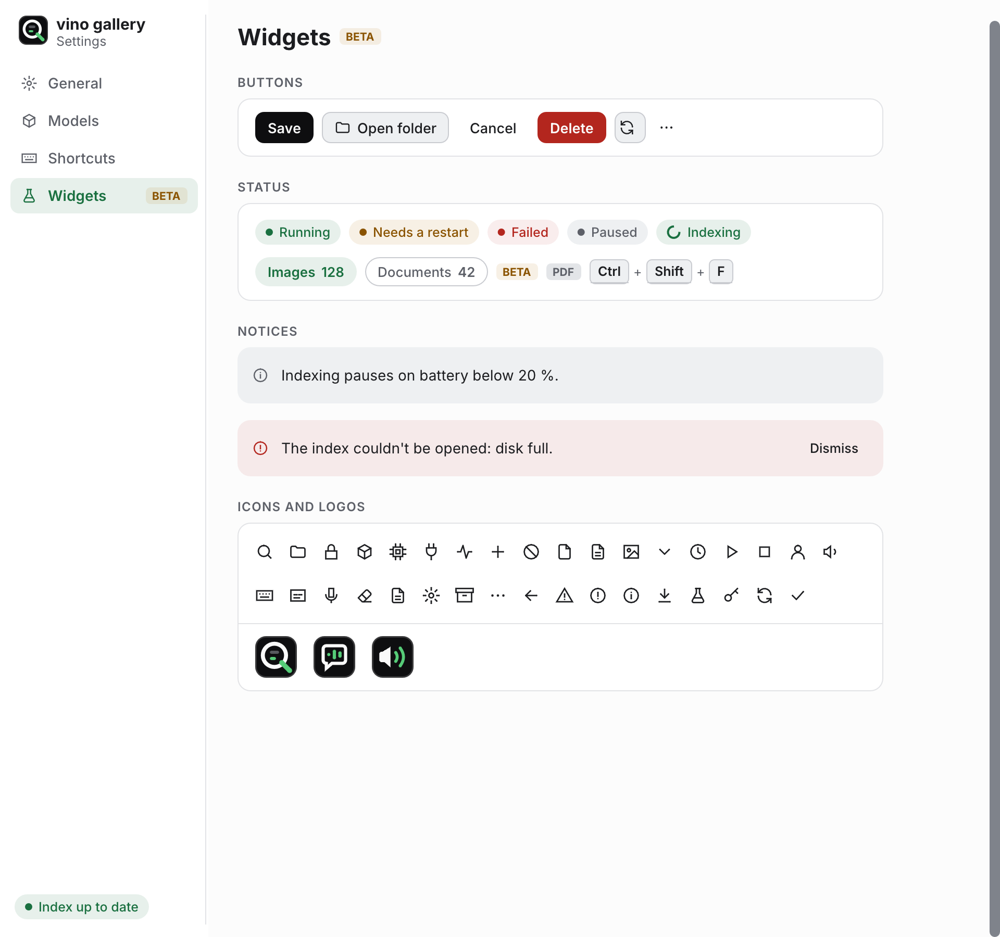

# vinoUserInterface

The egui theme and widgets shared by [vinoSearch](https://github.com/karanshukla/vinoSearch),
[vinoWhisper](https://github.com/karanshukla/vinoWhisper) and
[vinoSpeak](https://github.com/karanshukla/vinoSpeak): one look, built on
vinopilot.ca's site.css. Inter, flat surfaces separated by hairlines, ink and
green. The boards it implements are on the
[vino UI canvas](https://claude.ai/code/artifact/f79675d7-67e0-4a99-a84d-8a22d3b3a8f6);
how to put the parts together is in [DESIGN.md](DESIGN.md).

<p align="center">
  
  
</p>

Built for laptops, and for half of one. Snapped next to another window, a
page swaps its sidebar for tabs and keeps its rows wide:


## Using it

```toml
[dependencies]
vino-user-interface = "0.2"
eframe = { version = "0.37", default-features = false, features = ["accesskit", "default_fonts", "glow", "wayland"] }
```

A settings page: a group of rows, a banner, a status line.

```rust
use eframe::egui;
use vino_user_interface::{Button, ChipKind, Row, Tone, a11y, theme, widgets};

#[derive(Default)]
struct Settings {
    images: bool,
    folder: String,
}

impl eframe::App for Settings {
    fn ui(&mut self, ui: &mut egui::Ui, _frame: &mut eframe::Frame) {
        let p = theme::palette(ui.ctx());
        egui::CentralPanel::default()
            .frame(egui::Frame::NONE.fill(p.bg).inner_margin(egui::Margin {
                left: 28,
                top: 20,
                ..Default::default()
            }))
            .show(ui, |ui| {
                widgets::page_scroll(ui, "Settings", widgets::CONTENT_MAX, |ui| {
                    widgets::title(ui, "Settings");
                    widgets::group_label(ui, "What to index");
                    widgets::group(ui, |ui| {
                        Row::new("Images")
                            .help("By what's in them, not just the name.")
                            .show(ui, |ui, _| {
                                widgets::switch(ui, &mut self.images, "Images");
                            });
                        // `named` gives the field the row's title as its accessible name.
                        Row::new("Folder").show(ui, |ui, named| {
                            named(ui.add(widgets::field(&mut self.folder, "~/Pictures", 180.0)));
                        });
                    });
                    widgets::banner(ui, Tone::Warn, "The vision model isn't downloaded yet.", |ui| {
                        ui.add(Button::primary("Download").small());
                    });
                    a11y::live(&widgets::chip(ui, ChipKind::Ok, "Index up to date"));
                });
            });
    }
}

fn main() -> eframe::Result {
    eframe::run_native(
        "Settings",
        eframe::NativeOptions {
            viewport: egui::ViewportBuilder::default()
                .with_inner_size([960.0, 680.0])
                .with_min_inner_size([340.0, 320.0]),
            ..Default::default()
        },
        Box::new(|cc| {
            // Fonts, colours and spacing, then the desktop's light or dark and motion setting.
            theme::install(&cc.egui_ctx);
            Ok(Box::new(Settings::default()))
        }),
    )
}
```

The full window, with the sidebar that folds into tabs at `SIDEBAR_FROM`, is
[examples/gallery.rs](examples/gallery.rs). Run it and drag the window
narrower:

```sh
cargo run --example gallery
```

## What is in it

| Module | Holds |
|---|---|
| `theme` | the tokens for dark and light, fonts, egui's visuals and spacing, and what the desktop asks for: light or dark (the Settings portal), text size, reduced motion, KDE's header colours |
| `widgets` | group + row, switch, segmented control, the four button kinds, status text, filter chip, tag, key caps, progress and share bars, banner, notice, nav item, underline tab, selection ring and tint, a 10 fps spinner for real waits, the page scroll area, and the layout constants |
| `icons` | a 16 px stroke icon set painted from SVG path data (no icon font), `Icon::ALL` for the lot |
| `logo` | the three app logos, painted at any size |
| `a11y` | headings, tabs, list boxes, live regions and naming for screen readers |

<p align="center">
  
  
</p>

Colour has one job each: green means on, selected or done; amber means it
needs you; red means it failed. Status is words, not dots or pills, and
nothing moves but feedback: a switch sliding, a spinner during a real wait.
Menus and popups are the only shadowed surface.

## Rules the code keeps

- Text is 4.5:1 and the edges of controls 3:1 against the page, a surface, a
  field and the three tints, in both themes. `cargo test` checks it over the
  visuals as installed; a token that fails it does not ship.
- Every control has a role and a name, is 24 px or has room around it, and
  Tab reaches it. `tests/a11y.rs` checks that over the AccessKit tree, in both
  themes, wide and narrow; CI runs it as its own `a11y` check.
- A row lays its controls out from the right. A composite widget inside one
  sizes itself up front and lays out left to right (see `segmented`, `keys`).
- `widgets::switch` and the buttons are their own widgets, not styled egui
  ones, so they can say what they are to a screen reader: a switch is a
  `Switch` with the row's title for its name.
- The bundled fonts are Latin subsets (`assets/fonts/README.md`). egui falls
  back to its own fonts for other glyphs, and a glyph no font has panics in a
  test, so check before putting a symbol in a window.

## Checking a window by eye

The README's pictures are the gallery rendered offscreen with wgpu. After a
visual change, redraw them and commit `docs/images`:

```sh
cargo test --test screenshots -- --ignored
```

`VINO_UI_THEME=light|dark` forces the theme on a desktop without a portal.
`scripts/shot.sh OUT THEME W H CMD...` runs a window as a floating `W x H`
window on a sway desktop (the linuxlab VM's headless one) and screenshots it
with grim.

## Releasing

Bump `version` in `Cargo.toml`, merge, then push a matching tag:
`git tag v0.1.1 && git push origin v0.1.1`. The release workflow reruns the
checks and publishes to crates.io. Then bump each app.
