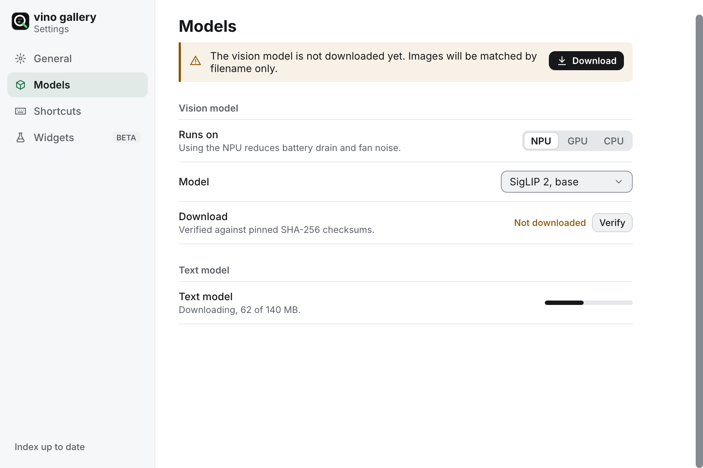
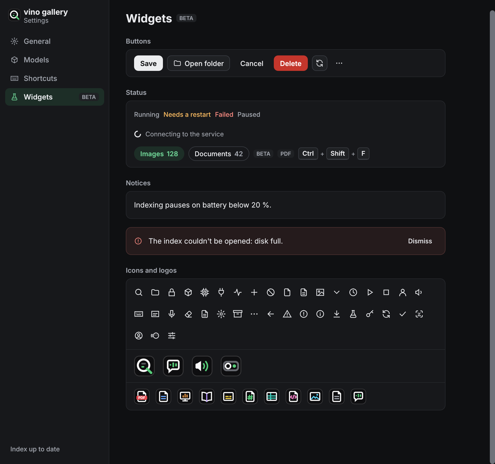
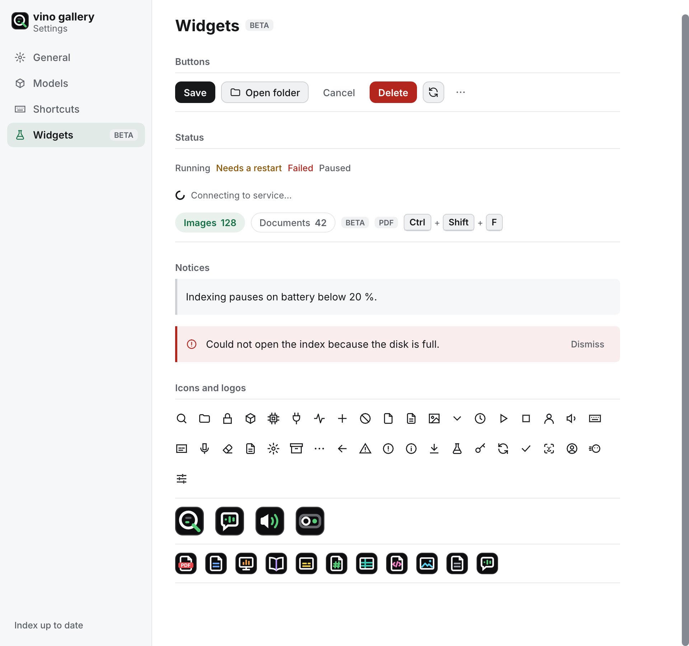

# vinoUserInterface

Shared egui theme and widget library for the [vinoPilot](https://vinopilot.ca/)
desktop apps. It provides a consistent look across apps using Inter, flat
surfaces separated by hairlines, and the ink-and-green palette from
vinopilot.ca's `site.css`.

<p align="center">
  
  
</p>

Layouts are designed for laptop displays, including half-screen tiled windows.
When a window is snapped next to another app, the sidebar switches to top tabs
so setting rows keep their horizontal layout:


## Requirements

- Rust 1.95 and egui 0.37 (each application provides its own `eframe`
  dependency).
- `busctl` or `gdbus` on `PATH` to read the desktop's light/dark preference,
  text scale, and reduced-motion setting. Without them, the crate uses egui's
  default theme at 1x scale.
- `curl`, used only when the user clicks **Check for updates** on the About
  page.

## Quick start

```toml
[dependencies]
vino-user-interface = "0.5"
eframe = { version = "0.37", default-features = false, features = ["accesskit", "default_fonts", "glow", "wayland"] }
```

System tray processes that do not link egui can set `default-features = false`
to include only `family`, `tray`, and `update`.

Example settings page with a row group, a warning banner, and a live status
indicator:

```rust
use eframe::egui;
use vino_user_interface::{Button, ChipKind, Row, Tone, a11y, theme, widgets};

#[derive(Default)]
struct Settings {
    images: bool,
    folder: String,
}

impl eframe::App for Settings {
    fn ui(&mut self, ui: &mut egui::Ui, _frame: &mut eframe::Frame) {
        let p = theme::palette(ui.ctx());
        egui::CentralPanel::default()
            .frame(egui::Frame::NONE.fill(p.bg).inner_margin(egui::Margin {
                left: 28,
                top: 20,
                ..Default::default()
            }))
            .show(ui, |ui| {
                widgets::page_scroll(ui, "Settings", widgets::CONTENT_MAX, |ui| {
                    widgets::title(ui, "Settings");
                    widgets::group_label(ui, "What to index");
                    widgets::group(ui, |ui| {
                        Row::new("Images")
                            .help("Index image contents as well as file names.")
                            .show(ui, |ui, _| {
                                widgets::switch(ui, &mut self.images, "Images");
                            });
                        // `named` gives the field the row's title as its accessible name.
                        Row::new("Folder").show(ui, |ui, named| {
                            named(ui.add(widgets::field(&mut self.folder, "~/Pictures", 180.0)));
                        });
                    });
                    widgets::banner(ui, Tone::Warn, "The vision model is not downloaded yet.", |ui| {
                        ui.add(Button::primary("Download").small());
                    });
                    a11y::live(&widgets::chip(ui, ChipKind::Ok, "Index up to date"));
                });
            });
    }
}

fn main() -> eframe::Result {
    eframe::run_native(
        "Settings",
        eframe::NativeOptions {
            viewport: egui::ViewportBuilder::default()
                .with_inner_size([960.0, 680.0])
                .with_min_inner_size([340.0, 320.0]),
            ..Default::default()
        },
        Box::new(|cc| {
            // Install bundled fonts, colours, spacing, and desktop theme/motion preferences.
            theme::install(&cc.egui_ctx);
            Ok(Box::new(Settings::default()))
        }),
    )
}
```

See [examples/gallery.rs](examples/gallery.rs) for a complete demo window. Run
it and resize the window to see the responsive breakpoints:

```sh
cargo run --example gallery
```

## Modules

| Module | Contents |
|---|---|
| `theme` | Dark and light colour tokens, bundled fonts, egui visuals and spacing, and desktop preference detection |
| `widgets` | Row groups, switches, buttons, status text, chips, tags, key caps, banners, navigation, page scroll areas, and layout constants |
| `icons` | 16 px stroke icon set painted directly from SVG path data without an icon font |
| `logo` | Vector app logos rendered at any size |
| `file_tile` | File list tiles with a distinct shape and accent colour per file format |
| `a11y` | Accessibility helpers for headings, tabs, list boxes, live regions, and screen-reader labels |
| `window` | Client-side title bar and resize handles for windows rendered without desktop decorations |
| `about`, `update` | Shared About page and on-demand update checker/installer row |
| `family`, `tray` | App catalog, website links, and standard symbolic icon names for tray menus (no egui dependency) |

<p align="center">
  
  
</p>

## Documentation

- [DESIGN.md](DESIGN.md): Layout rules, responsive breakpoints, design tokens,
  component guidelines, motion, and UI copy conventions.
- [docs/development.md](docs/development.md): Test invariants, source layout,
  regenerating screenshots, and release steps.
- [SECURITY.md](SECURITY.md): Network and system access, security controls, and
  vulnerability reporting.
- [The vino UI canvas](https://claude.ai/code/artifact/f79675d7-67e0-4a99-a84d-8a22d3b3a8f6):
  Design boards this library implements.
